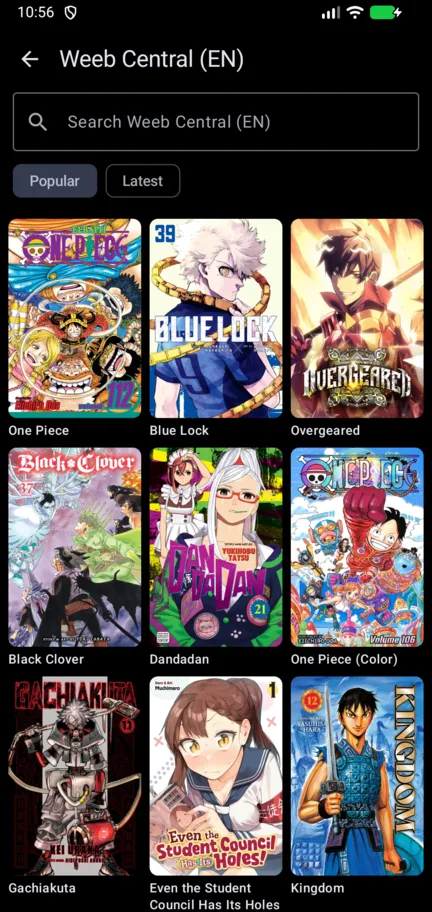

# Updates, history and browsing

## Updates

Recently fetched chapters of every title in the library, newest first, grouped by day. Tap a chapter to read it, tap
the cover to open the series, or download it with the button on the right.

## History

What you read last, one entry per series, with the page you stopped at. It's the server's history, so chapters read in
the Suwayomi web UI or on another device appear too.

## Browse

  <figure><figcaption>Popular titles of a source</figcaption></figure>

Lists the sources installed on your server (extensions are installed in the Suwayomi web UI). By default only English,
multi-language sources and your phone's language are shown; **All languages** shows the rest.

Open a source to see its popular or latest titles, or search it. A heart marks titles already in your library. Open a
title to read it without adding it, or tap **Add to library**; that adds it on the server, so it appears everywhere.
