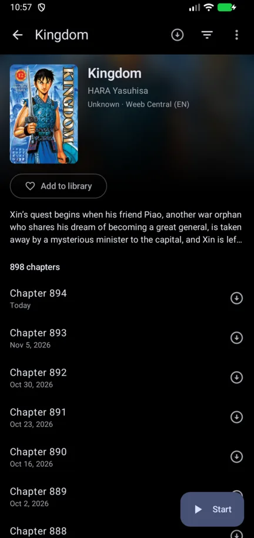
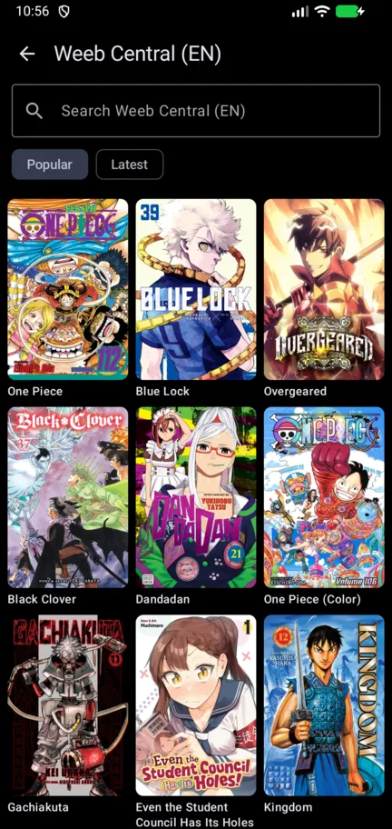

  
  
<strong>Suwa</strong> is a native Android reader for your <a href="https://github.com/Suwayomi/Suwayomi-Server">Suwayomi</a> server. Your library, categories, chapters and reading progress live on the server, and the phone shows exactly that, with a copy kept for offline reading.

  <figure><figcaption>Series page</figcaption></figure>
  <figure><figcaption>Long-strip reader</figcaption></figure>
  <figure><figcaption>Browse a source</figcaption></figure>

## Why another client?

Mihon (and Tachiyomi before it) keeps its own library on the phone. When you pair it with Suwayomi through the
Suwayomi extension, the phone's library points at Suwayomi's internal IDs. Migrate a title to another source on the
server and those IDs change, so the phone's copy breaks and you have to migrate it a second time in Mihon.

Suwa doesn't keep a library of its own. It shows the server's library, 1:1:

- Add, remove or migrate a title on the server, or in the Suwayomi web UI, and the phone shows it on the next refresh.
- Read on the phone and the progress goes to the server, so every device, including the web UI, picks up where you
  left off.
- Offline, you read what you downloaded. Progress made offline is queued and sent once the server is reachable.

## What you get

- **A real reader.** The paged and long-strip viewers are Mihon's, so zoom, tap zones, cropping, wide-page splitting
  and preloading all behave the way you're used to.
- **Offline downloads.** Downloads run several chapters at once, retry on failure and are stored per chapter on the phone.
- **Updates, history and browse**, served by your Suwayomi server.
- **Shared reader settings.** The reading mode for each series, and reading-related reader settings, are stored on the
  server and shared across devices.
- **In-app updates** from GitHub releases. Each APK's checksum and signing key are checked before it's installed.

Get started with [Install](install.md).
