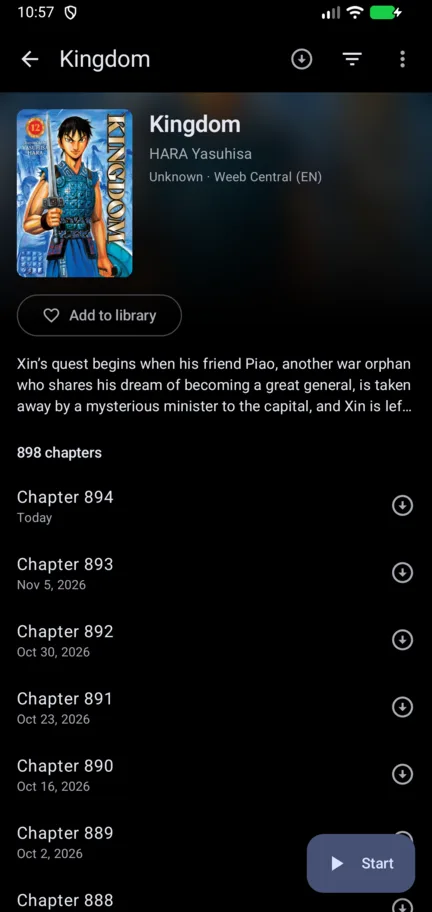

# Library and series

## Library

The library is the server's library: the same titles and categories as the Suwayomi web UI.

- **Categories** are tabs. Titles that belong to no category appear under *Default*.
- **Badges** show unread chapters and chapters downloaded on this phone.
- **Filter and sort** (the funnel icon): unread only, downloaded only, sort by title, last read, unread count, latest
  chapter or date added; grid size and badges.
- **Pull down** to refresh from the server. The library also refreshes when the app opens and every few minutes while
  it's on screen.
- **⋮ → Check sources for new chapters** asks the server to run its library update, then refreshes when it's done.

While the server can't be reached, a banner says so and everything shows what was saved on the phone.

## Series page

  <figure><figcaption>Series page</figcaption></figure>

- **Continue / Start** opens the first unread chapter, or the one you stopped in the middle of.
- **Add to library / In library** adds or removes the title on the server. Removing it also deletes its downloads on
  this phone.
- **Download** (the arrow icon): the next 1, 5, 10 or 25 unread chapters, all unread, everything, or delete downloads.
- **Filter**: hide read chapters, oldest or newest first.
- **⋮**: re-fetch from the source (new chapters, updated description), edit categories, open the source's web page.

Long-press a chapter to select it; long-press another to select the range in between. With chapters selected you can
mark them read or unread, mark everything before them read, bookmark, download or delete their downloads.
