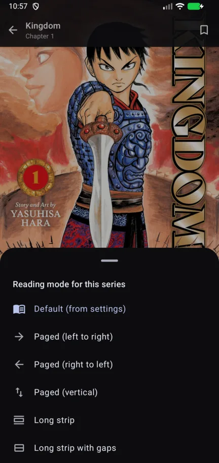
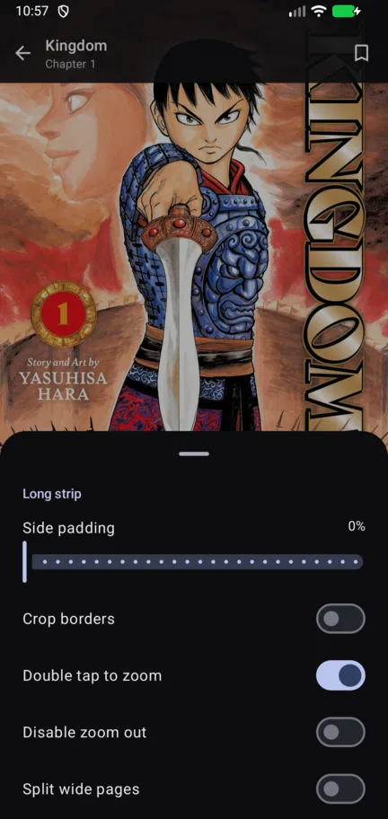

# Reading

  <figure><figcaption>Menu over the reader</figcaption></figure>
  <figure><figcaption>Reading mode per series</figcaption></figure>
  <figure><figcaption>Reader settings</figcaption></figure>

The reader is [Mihon's](https://github.com/mihonapp/mihon): the same paged and long-strip viewers, tap zones,
zooming, border cropping and wide-page splitting.

- **Tap the middle** of the page (or long-press, if enabled) to show the menu: chapter title, bookmark, page slider,
  previous and next chapter, reading mode, rotation and settings.
- **Reading modes**: paged left to right, right to left, vertical, long strip, and long strip with gaps. The reading
  mode button sets it *for this series*; the default for everything else is in the reader settings.
- **Volume keys** can turn pages (reader settings → *Volume keys turn pages*).

## Progress

Progress is saved as you turn pages and sent to the server a moment later. Reaching the last page marks the chapter
read. Without a connection it's queued on the phone and sent when the server is back; see
[The server is the source of truth](sync.md).

## Settings that follow you

These are stored on the server and shared by every device running Suwa:

- the reading mode of each series, and its rotation lock;
- the default reading mode, background colour, page number, transitions, grayscale and inverted colours;
- paged options: scale type, zoom start, crop borders, landscape zoom, wide-page split and rotate, tap zones;
- long-strip options: side padding, crop borders, double-tap zoom, zoom out, wide-page split, tap zones.

Settings that depend on the device stay on it: keep screen on, volume keys, fullscreen, drawing under the camera
cutout, default rotation and "preload only on Wi-Fi".

If a series opens in a different mode than your default, it has its own mode. The reader settings say so under
*Default reading mode* and offer **Use default**.
